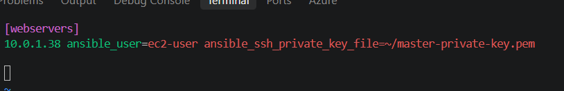
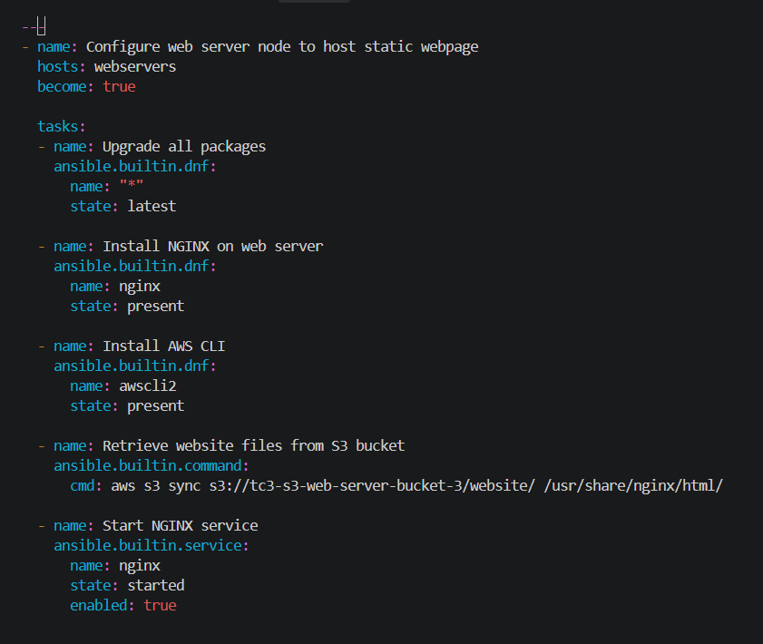
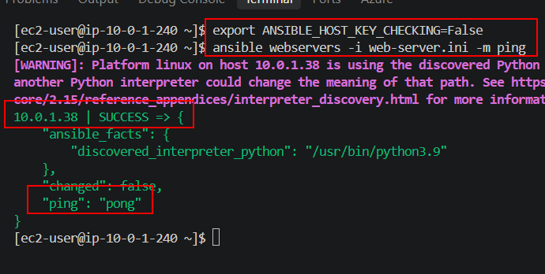
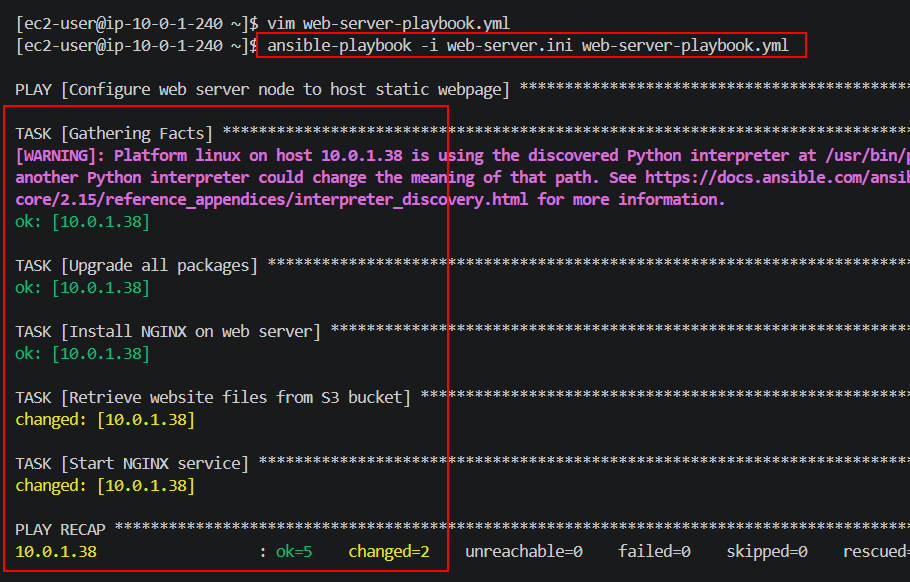

## AWS Cloud Engineer

**Greetings! We'll be going over the tasks for Tech Challenge 3 of the Cloud Engineering program. Lets get started!**

## Tech Challenge 3 - Action Steps

* Phase 1: Provision AWS Infrastructure with Terraform
* Phase 2: Configure the EC2 Web Server with Ansible
* Phase 3: EKS cluster setup and add-ons

________________________

## Tech Challenge Overview

Welcome to Tech Challenge 3! This Tech Challenge (TC) will be significantly easier to manage than all of our other projects. The overall goal is to host a static website in AWS. We'll use Terraform to provision the AWS environment with a VPC, EC2, and S3 bucket to support our static website. We'll then use Ansible to configure our EC2 instance with NGINX or Apache (most likely NGINX) to server our web page which will most likely be a simple "Hello, World!" message. Maybe we'll stylize it with CSS. Now, I'm altering the prompt a bit because the original prompt isn't forcing us to use the S3 bucket in our actual webpage deployment. We'll utilize the S3 bucket to hold the index.html and CSS files (because that's exactly what it's good for) and sync the EC2 directory mount with the bucket so it'll have access to the webpages. 

Lets do this!

## Phase 1: Provision AWS Infrastructure with Terraform

 For our TC, we'll need to deploy our AWS resources using Terraform (TF). We'll need a VPC with a public subnet internet gateway (IGW), a route table and a security group (SG) to allow SSH and HTTP traffic. We'll also need an EC2 instance and an S3 bucket. Lastly, we'll need to configure IAM roles for the EC2 to be able to access the S3 bucket's files. 

 Luckily for us, I have most of these resources created from previous projects so I'll just create the S3 bucket file and edit my other files. In our networking.tf block, I'm going to remove the NAT Gateway, private subnets, and one of the public subnets. We don't need all of that. I grabbed a generic S3 bucket resource block from the TF website. It was really simple so I'm not sure what else I needed to add. 

 For the security.tf file, I changed the name of the SG and allowed ports 22 and 80 for ingress. I allowed everything for egress. I pretty much kept my ec2.tf file the same besides changing the name of the IAM role. The iam.tf file gave me the most issues. I had to create an IAM role, policy document, policy, attach the policy document to the policy, and then attach the role to the IAM instance I believe. 

 UPDATE: Okay I was totally wrong about the IAM file. I just had Copilot create it for me because I just suck at this right now. We're also having TF inject the index.html and style.css files directly into the S3 bucket upon creation which means we need to generate some code for that as well. AI came up with the two resource blocks in the S3 file as well. Last but not least, after running into some issue installing Ansible on my local machine, I'm going to make another EC2 instance as my Ansible control node. We'll work from there and make sure we're able to SSH into my web server node for operations. 

 I created my GitHub TC3 repo and pushed all of my files up to it. Then, I initialized terraform and did a format and validate. I ran into an issue regarding the SG public IP (PIP) reference. I removed this configuration because security isn't a huge concern here. 

 

 Now, lets deploy everything! We'll do a terraform fmt -recursive, validate and plan before we apply it all. Once everything looks good, we'll continue. 

 

Looks like everything worked out perfectly! 

 

Lets get logged into our EC2 instance so we can continue with the Ansible automation section of this project. Lets move on to Phase 2!

## Phase 2: Configure the EC2 Web Server with Ansible

Alright now lets get our EC2 instance configured for our static webpage. At first, I was going to use my local computer as the Ansible control but after dealing with installation issues, I'm switching back to creating an EC2 instance as my Ansible control node. Once you log into your control node, install Ansible and create the files for both your inventory and playbook. 

We'll only have one entry in our inventory file for our web server. 

We'll only have one entry in our inventory file for our web server. [explain the rest of the commands in here as well]

For our playbook file, I had majority of this file designed already from a previous web server lab. The two sections we added were installing the AWS CLI task and then syncing our S3 bucket's file path with the file path on our EC2 instance so NGINX can always see the web pages. 

We'll do a ping test to make sure our controller node can access our web server node. Run the command `` to complete the ping test. 

Lastly, we'll run our playbook and confirm Ansible has completed all of our tasks for us. Run the command `` to run our playbook. 

Automation is pretty time consuming up front but once you get the configurations completed, you're good to go! 

Lets move to Phase 3 to wrap this project up. 

## Phase 3: 

This phase w

That concludes all of our Tech Challenges!