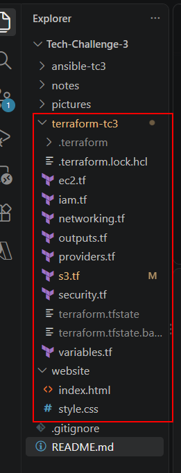
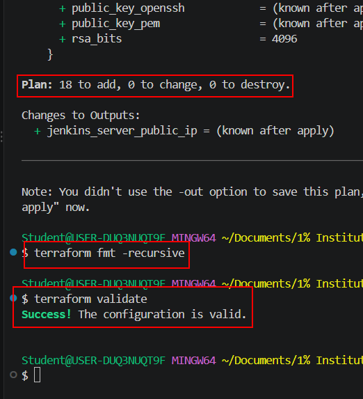
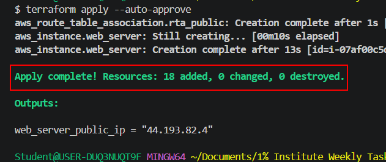
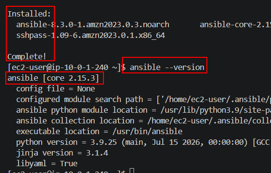
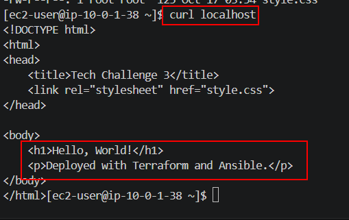

## AWS Cloud Engineer

**Greetings! We'll be going over the tasks for Tech Challenge 3 of the Cloud Engineering program. Lets get started!**

## Tech Challenge 3 - Action Steps

* Phase 1: Provision AWS Infrastructure with Terraform
* Phase 2: Terraform the AWS environment
* Phase 3: EKS cluster setup and add-ons

________________________

## Tech Challenge Overview

Welcome to Tech Challenge 3! This Tech Challenge (TC) will be significantly easier to manage than all of our other projects. The overall goal is to host a static website in AWS. We'll use Terraform to provision the AWS environment with a VPC, EC2, and S3 bucket to support our static website. We'll then use Ansible to configure our EC2 instance with NGINX or Apache (most likely NGINX) to server our web page which will most likely be a simple "Hello, World!" message. Maybe we'll stylize it with CSS. Now, I'm altering the prompt a bit because the original prompt isn't forcing us to use the S3 bucket in our actual webpage deployment. We'll utilize the S3 bucket to hold the index.html and CSS files (because that's exactly what it's good for) and sync the EC2 directory mount with the bucket so it'll have access to the webpages. 

Lets do this!

## Phase 1: Provision AWS Infrastructure with Terraform

 For our TC, we'll need to deploy our AWS resources using Terraform (TF). We'll need a VPC with a public subnet internet gateway (IGW), a route table and a security group (SG) to allow SSH and HTTP traffic. We'll also need an EC2 instance and an S3 bucket. Lastly, we'll need to configure IAM roles for the EC2 to be able to access the S3 bucket's files. 

 Luckily for us, I have most of these resources created from previous projects so I'll just create the S3 bucket file and edit my other files. In our networking.tf block, I'm going to remove the NAT Gateway, private subnets, and one of the public subnets. We don't need all of that. I grabbed a generic S3 bucket resource block from the TF website. It was really simple so I'm not sure what else I needed to add. 

 For the security.tf file, I changed the name of the SG and allowed ports 22 and 80 for ingress. I allowed everything for egress. I pretty much kept my ec2.tf file the same besides changing the name of the IAM role. The iam.tf file gave me the most issues. I had to create an IAM role, policy document, policy, attach the policy document to the policy, and then attach the role to the IAM instance I believe. 

 UPDATE: Okay I was totally wrong about the IAM file. I just had Copilot create it for me because I just suck at this right now. We're also having TF inject the index.html and style.css files directly into the S3 bucket upon creation which means we need to generate some code for that as well. AI came up with the two resource blocks in the S3 file as well. 

 

 

 

Now, lets terraform our infrastructure so that we can run all of this in the cloud. 

## Phase 2: 

We need to make sure our entire AWS environment can automatically be deployed to support our application. We'll use Infrastructure as Code (IaC) via Terraform (TF) to deploy our environment. Now, in Project 2, we already created an Elastic 

There were a few modifications post-apply that were added but they should be included in the final TF code inside the repo. Lets move to Phase 3. 

## Phase 3: EKS cluster setup and add-ons

This phase was extremely command heavy. Overall, we basically needed to set up the Jenkins server EC2 instance to be able to run all of our operations. We needed to install the CLI for AWS, Git, Docker, kubectl, and Helm. I've included the commands to install all of these tools. In the future, I may create an Ansible playbook for this entire section and just run it. 

That concludes all of our Tech Challenges!